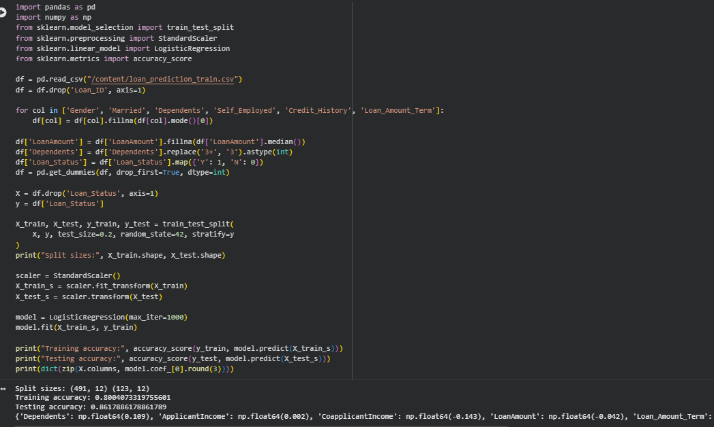
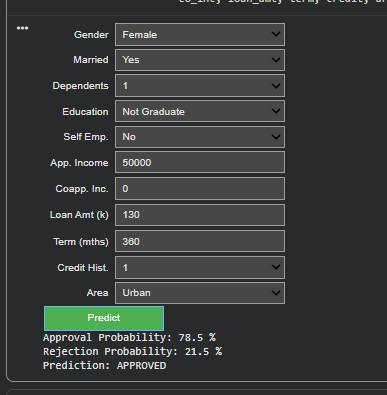

# Loan Approval Prediction

A machine learning project that predicts whether a loan application will be approved or rejected, along with the approval probability. The model is Logistic Regression, served through a Streamlit web app.

**Live app:** DEPLOYED-APP-LINK

## 1. Problem Statement

Banks must decide quickly which loan applications to approve. This project builds a binary classification model that uses applicant details (income, credit history, loan amount, property area, etc.) to predict Loan_Status: 1 = approved, 0 = rejected.

## 2. Dataset

- File: `loan_prediction_train.csv` (Loan Prediction dataset)
- Size: 614 rows and 13 columns
- Target: Loan_Status (Y / N)
- Features: Gender, Married, Dependents, Education, Self_Employed, ApplicantIncome, CoapplicantIncome, LoanAmount, Loan_Amount_Term, Credit_History, Property_Area
- Loan_ID is an identifier and was dropped.

## 3. Data Preprocessing

1. Dropped Loan_ID.
2. Filled missing values: Gender, Married, Dependents, Self_Employed, Credit_History and Loan_Amount_Term with the mode; LoanAmount with the median.
3. Converted Dependents value "3+" to 3 and made it an integer.
4. Encoded the target: Y = 1, N = 0.
5. One-hot encoded the categorical columns (drop_first=True), giving 12 input features.
6. Split the data 80/20 into training (491 rows) and testing (123 rows) sets with random_state=42 and stratify=y.
7. Scaled features with StandardScaler (fitted on the training set only).

## 4. Exploratory Analysis: Key Findings

- 68.7% of loans are approved and 31.3% rejected, so the data is imbalanced towards approval.
- Credit history is the strongest signal: applicants with good credit history were approved 79.0% of the time, against only 7.9% with bad credit history (after filling missing values).
- Semiurban areas have the highest approval rate (76.8%), then Urban (65.8%) and Rural (61.5%).
- Graduates were approved 70.8% of the time, non-graduates 61.2%.
- Missing values were found in Credit_History (50), Self_Employed (32), LoanAmount (22), Dependents (15), Loan_Amount_Term (14), Gender (13) and Married (3).

## 5. Model

Logistic Regression (scikit-learn, max_iter=1000). The target is a yes/no outcome, so a classification model is needed. Logistic Regression is simple, fast, easy to interpret and gives a probability for each prediction. The largest coefficient belongs to Credit_History (1.237), followed by Property_Area_Semiurban (0.363) and Married_Yes (0.254).

## 6. Training Process

The model was trained on the 491 training rows after scaling. Training accuracy is 0.80.

## 7. Evaluation Results (test set, 123 rows)

| Metric | Value |
|---|---|
| Accuracy | 0.8618 |
| Precision | 0.8400 |
| Recall | 0.9882 |
| F1 Score | 0.9081 |
| ROC-AUC | 0.8486 |

Confusion matrix:

|  | Predicted Reject | Predicted Approve |
|---|---|---|
| Actual Reject | 22 | 16 |
| Actual Approve | 1 | 84 |

The model finds almost every approved loan (recall 0.99) but misses many rejected ones (recall 0.58): 16 loans that should have been rejected were approved.

## 8. Prediction Results

The app returns the approval probability, the rejection probability and the final decision. A loan is approved when the approval probability is 50% or higher. Sample test cases:

| Case | Credit history | Property area | Loan term | Approval probability | Prediction |
|---|---|---|---|---|---|
| 1 | 0 (bad) | Urban | 280 | 5.5% | Rejected |
| 2 | 1 (good) | Urban | 280 | 75.3% | Approved |
| 3 | 1 (good) | Semiurban | 375 | 85.0% | Approved |
| 4 | 0 (bad) | Semiurban | 375 | 13.4% | Rejected |

Cases 3 and 4 differ only in credit history, and the approval probability falls from 85.0% to 13.4%.

Example from the application form (approved with 78.5% probability):

## 9. Files in this Repository

- `app.py`: Streamlit web application (preprocessing, training and prediction)
- `requirements.txt`: Python libraries needed
- `loan_prediction_train.csv`: dataset
- `evaluation.png`, `local_app.png`, `deployed_app.png`: screenshots

## 10. How to Run

1. Download or clone this repository.
2. Install the libraries: `pip install -r requirements.txt`
3. Start the app: `streamlit run app.py`

## 11. Limitations

- Small dataset (614 rows), so results can change with a different split.
- Class imbalance: the model leans towards approving loans (rejected-class recall is only 0.58). class_weight="balanced", more data or threshold tuning could help.
- Logistic Regression is linear and may miss complex patterns; other models such as Random Forest could be compared.
- The dataset has no information on existing debts or employment history.
- The model uses attributes such as gender and marital status, which should not be used in real lending decisions without a fairness review.
- For learning purposes only, not for real loan decisions.
